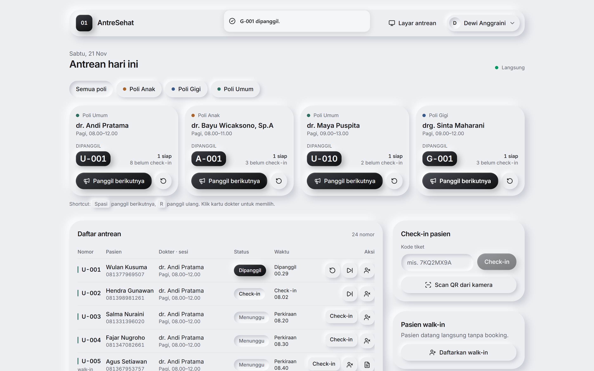
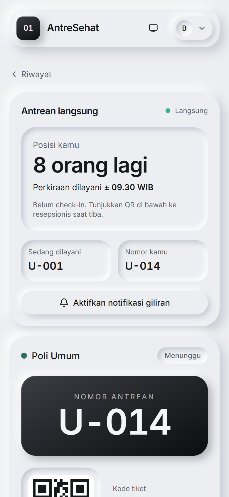
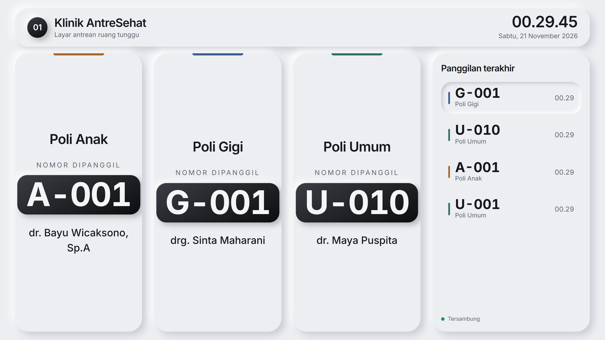
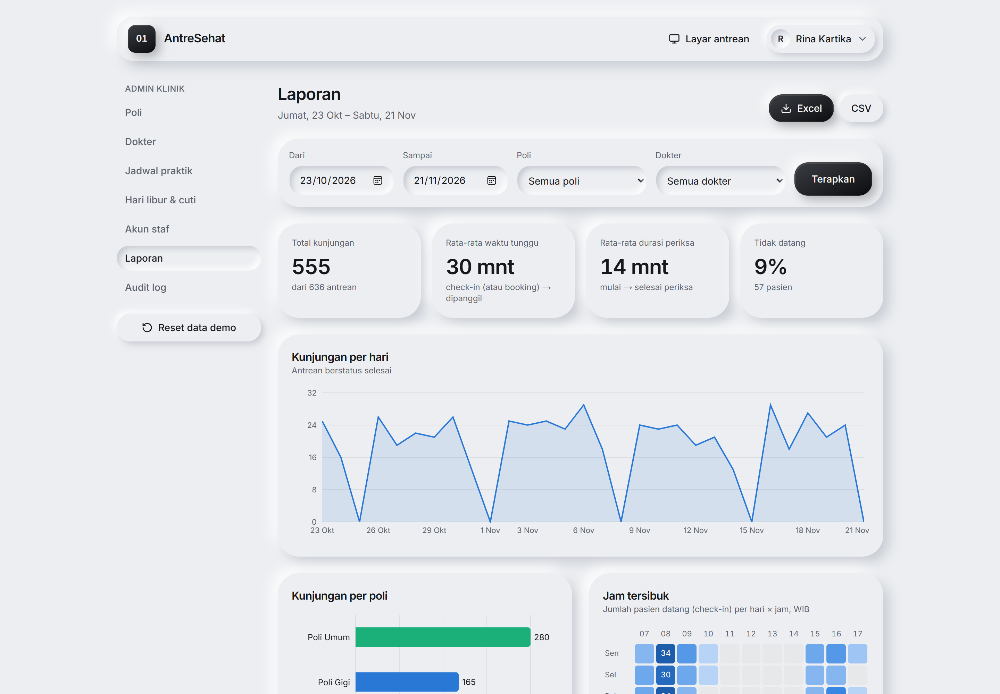
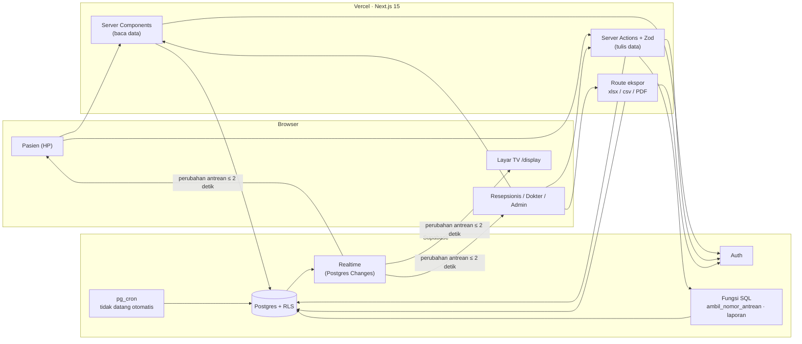

# AntreSehat

[](https://github.com/istu2174/antresehat/actions/workflows/ci.yml)

**Booking dan antrean klinik online yang realtime.** Pasien booking dari HP lalu memantau posisinya secara
langsung. Resepsionis memanggil dengan satu klik, dan layar TV ruang tunggu menampilkan sekaligus
menyuarakan nomor yang dipanggil.

**Demo:** `https://DOMAIN-DEMO` (isi setelah deploy) · Tidak perlu daftar, cukup tekan **Masuk sebagai (demo)** di halaman login.

> Demo portofolio. Semua data fiktif dan bukan untuk penggunaan medis.

| Dashboard resepsionis | Tiket pasien |
|---|---|
|  |  |
| **Layar TV ruang tunggu** | **Laporan admin** |
|  |  |

## Skenario demo 1 menit

1. Buka [`/display`](https://DOMAIN-DEMO/display) di satu jendela, lalu klik **Aktifkan suara**.
2. Di jendela lain, buka [`/login`](https://DOMAIN-DEMO/login) → **Masuk sebagai Resepsionis**.
3. Letakkan kedua jendela berdampingan, lalu klik **Panggil berikutnya** di salah satu kartu dokter.
4. Dalam ±1 detik layar TV berganti nomor, bunyi bel, dan menyuarakan *"Nomor antrean U, dua, silakan ke Poli Umum"*.
5. Masuk sebagai **Pasien** di HP. Tiket `U-xxx` menunjukkan posisi dan perkiraan jam dilayani. Status tiket ikut berubah saat dipanggil.

## Fitur per role

| Role | Yang bisa dilakukan |
|---|---|
| **Pasien** | Booking 4 langkah (poli → dokter → tanggal → sesi) dengan sisa kuota terlihat. Tiket berisi QR dan perkiraan jam dilayani. Posisi antrean dipantau realtime, ada notifikasi browser saat tinggal 3 nomor dan saat dipanggil. Bisa membatalkan booking (≥ 1 jam sebelum sesi), melihat riwayat kunjungan beserta ringkasan dokter, dan mengisi profil (NIK disamarkan). |
| **Resepsionis** | Dashboard antrean hari ini dengan filter poli. Check-in lewat scan QR kamera atau ketik kode. Pendaftaran pasien walk-in. Panggil berikutnya / panggil ulang / lewati / tandai tidak datang, juga lewat shortcut keyboard. Tiket PDF ukuran struk 58 mm. |
| **Dokter** | Daftar pasien hari ini sesuai urutan, mulai periksa, dan form catatan (keluhan, tensi/suhu/berat, diagnosis + ICD-10, tindakan, resep, saran). Durasi periksa tercatat otomatis. Bisa melihat riwayat kunjungan pasien. |
| **Admin** | CRUD poli, dokter, dan jadwal praktik (kuota, menit per pasien). Hari libur / dokter cuti otomatis menutup booking dan menampilkan daftar pasien terdampak dengan link WhatsApp. Kelola akun staf dan reset password. Laporan + ekspor Excel/CSV, audit log, dan tombol **Reset data demo**. |
| **Layar TV** (tanpa login) | Nomor yang dipanggil per poli, 5 panggilan terakhir, bel, dan suara `id-ID` (Web Speech API). |

Aturan bisnis yang dijalankan di database:

- Nomor `U-001` di-reset tiap hari per poli dan dibuat di dalam transaksi (tidak pernah dobel, ada test-nya).
- 1 booking aktif per poli per hari. Booking dibuka H-7 dan ditutup 30 menit sebelum sesi berakhir.
- Pasien yang dilewati digeser 3 posisi; setelah dilewati 2× statusnya menjadi tidak datang.
- Booking yang belum check-in sampai 15 menit setelah estimasinya otomatis ditandai **tidak datang** (pg_cron tiap menit) dan kuotanya kembali.

## Stack

Next.js 15 (App Router, Server Actions) · TypeScript strict · Tailwind CSS v4 + shadcn/ui · Supabase (Postgres, Auth,
Row Level Security, Realtime, pg_cron) · Zod · Recharts · exceljs · pdf-lib · qrcode + @zxing/browser ·
Vitest · Playwright · GitHub Actions · Vercel

## Arsitektur



- **Keamanan di database, bukan di UI.** Setiap tabel memakai RLS. Pasien hanya bisa melihat datanya sendiri, dokter
  hanya antreannya sendiri, dan catatan kunjungan hanya untuk dokter, admin, dan pasien yang bersangkutan.
  Server Action memvalidasi semua input dengan Zod, lalu mengecek role sekali lagi.
- **Penomoran anti-dobel.** `ambil_nomor_antrean()` memakai advisory lock per (tanggal, poli) di dalam transaksi.
- **Agregasi laporan** dihitung di Postgres (`laporan()`), sehingga angka di layar, Excel, dan CSV identik.
- **Realtime.** Halaman berlangganan Postgres Changes tabel `antrean`. Anon hanya bisa membaca kolom yang tidak
  berisi data pribadi.

## Akun demo

Password semua akun: `demo1234`. Di halaman login juga ada tombol **Masuk sebagai (demo)**.

| Role | Email |
|---|---|
| Admin | admin@antresehat.test |
| Resepsionis | resepsionis@antresehat.test |
| Dokter Umum | dr.umum@antresehat.test |
| Dokter Gigi | dr.gigi@antresehat.test |
| Pasien | pasien@antresehat.test |

Seed berisi 3 poli, 4 dokter dengan jadwal Senin–Sabtu, 20 pasien fiktif, antrean hari ini dalam berbagai status,
dan riwayat 30 hari ke belakang. Admin bisa mengembalikan semuanya lewat **Reset data demo**.

## Menjalankan secara lokal

Butuh Node.js 20+ dan project Supabase (paket gratis cukup).

```bash
npm install
cp .env.example .env.local   # isi 3 nilai di bawah
npm run dev                  # http://localhost:3000
```

| Variabel | Dari Supabase → Project Settings → API |
|---|---|
| `NEXT_PUBLIC_SUPABASE_URL` | Project URL |
| `NEXT_PUBLIC_SUPABASE_ANON_KEY` | `anon` / publishable key |
| `SUPABASE_SERVICE_ROLE_KEY` | `service_role` / secret key. **Rahasia**, hanya dipakai di server (seed, akun staf, reset demo) |

### Menyiapkan database

1. Buat project di [supabase.com/dashboard](https://supabase.com/dashboard), region **Southeast Asia (Singapore)**.
2. **Authentication → Sign In / Providers → Email**: matikan **Confirm email** supaya akun demo bisa langsung masuk.
3. Jalankan migration secara berurutan:

   ```bash
   npx supabase login
   npx supabase link --project-ref <project-ref>   # ref ada di URL dashboard
   npm run db:push                                 # semua file di supabase/migrations/
   npm run db:seed                                 # data demo (aman diulang)
   ```

   Tanpa CLI: buka **SQL Editor**, lalu tempel dan jalankan tiap file di `supabase/migrations/` sesuai urutan nama.

| Migration | Isi |
|---|---|
| `…01_schema.sql` | Enum, tabel, index unik, trigger profil, NIK terenkripsi, `ambil_nomor_antrean()` |
| `…02_rls.sql` | Row Level Security semua tabel dan publikasi Realtime `antrean` |
| `…03_booking.sql` | `kuota_terpakai()` dan `batalkan_booking()` |
| `…04_laporan.sql` | `laporan()`: agregasi laporan (khusus admin) |
| `…05_tidak_datang_otomatis.sql` | Ekstensi pg_cron dan job tiap menit `tandai_tidak_datang()` |

## Test

```bash
npm test            # Vitest: format nomor, estimasi, aturan lewati, validasi Zod (juga dijalankan CI)
npm run test:db     # 20 booking paralel ke sesi berkuota 15 → nomor unik, tidak melebihi kuota (butuh .env.local)
npm run test:e2e    # Playwright: booking → check-in → panggil → tiket berubah → dokter selesai → riwayat
npm run lint && npm run typecheck
```

- Test integrasi dan E2E memakai database sungguhan. Data uji (pasien, poli, dokter, jadwal) dibuat sementara lalu dihapus lagi.
- E2E memakai Microsoft Edge yang sudah terpasang (`PW_CHANNEL=chrome` untuk Chrome). E2E dilewati pukul 23.25–24.00 WIB
  karena booking hari itu sudah ditutup.
- GitHub Actions (`.github/workflows/ci.yml`) menjalankan lint, typecheck, dan unit test di setiap push.

## Deploy ke Vercel + Supabase production

1. **Supabase production.** Buat project baru (Singapore), matikan **Confirm email**, lalu jalankan migration dan seed
   seperti di atas dengan `.env.local` yang mengarah ke project production.
   - Cek **Database → Extensions → pg_cron** aktif.
   - Cek **Integrations → Cron** memuat job `antresehat-tidak-datang`.
2. **Push ke GitHub**, lalu di [vercel.com/new](https://vercel.com/new) impor repo tersebut (framework terdeteksi otomatis).
3. **Environment Variables** (Production & Preview): isi 3 variabel dari tabel di atas.
   - Jangan beri prefix `NEXT_PUBLIC_` pada service role key.
4. **Deploy.** `vercel.json` menaruh fungsi di region `sin1` (Singapore), satu region dengan database, supaya respons cepat.
   - Vercel + Supabase tidak tidur seperti Render, jadi demo langsung terbuka.
5. **Domain.** Di Vercel → Settings → Domains, tambahkan domain (atau pakai `*.vercel.app`).
   - Lalu di Supabase → **Authentication → URL Configuration**, isi **Site URL** dengan domain itu dan tambahkan
     `https://<domain>/**` ke **Redirect URLs**.
6. **README.** Ganti `USERNAME` (badge CI) dan `DOMAIN-DEMO` (link demo) di bagian atas README.
7. **Cek setelah deploy:** login demo tiap role, buka `/display` + `/resepsionis` berdampingan lalu klik Panggil, ekspor laporan.

Catatan: tombol **Reset data demo** butuh ±40 detik. `maxDuration` halaman admin sudah 60 detik, sesuai batas paket Hobby Vercel.

## Struktur

```
src/
  app/                    route App Router (publik, pasien, resepsionis, dokter, admin, display)
  components/ui/          komponen shadcn yang sudah di-restyle neumorphism
  components/             komponen aplikasi (header, skeleton, form field, dll.)
  hooks/                  useAntreanRealtime: langganan Postgres Changes
  lib/actions/            Server Actions per role (validasi Zod + cek role)
  lib/                    aturan bisnis murni (antrean, booking, laporan), seed demo, client Supabase
supabase/migrations/      skema, RLS, fungsi SQL, cron
tests/                    unit (Vitest) · integration (DB) · e2e (Playwright)
```

## Desain

Neumorphism putih (`#eceef1`) dengan bayangan ganda. Gradasi hitam (`neu-ink`) hanya untuk aksi utama dan nomor antrean.
Tipografi Inter dengan angka `tabular-nums`, dan warna poli hanya dipakai sebagai aksen kecil.
Utility-nya ada di `src/app/globals.css`: `neu-raised`, `neu-raised-sm`, `neu-inset`, `neu-ink`.

Aksesibilitas: label untuk semua input, `aria-live` untuk perubahan antrean, bisa dinavigasi keyboard
(shortcut Spasi/R di dashboard resepsionis), dan huruf besar di layar TV. Lighthouse lokal (production build, mobile):
Performance 90–91, Accessibility 100, SEO 100.
